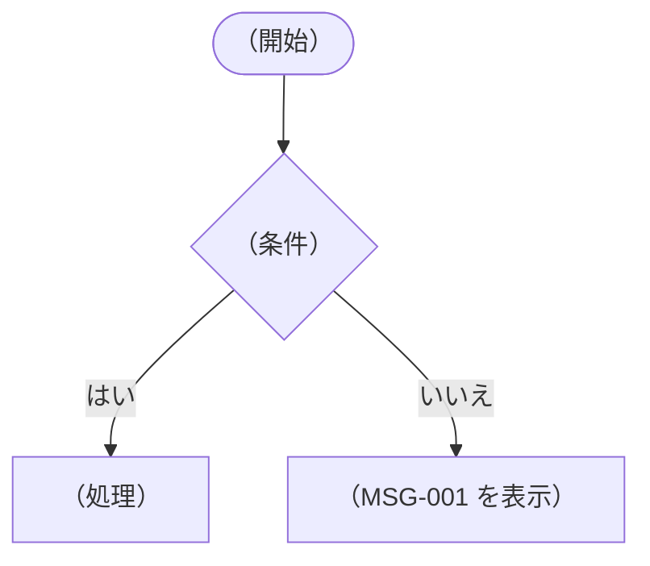
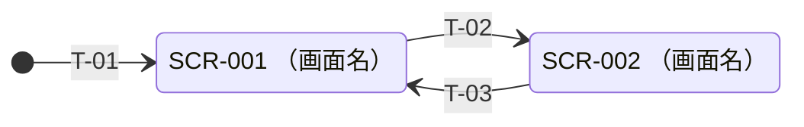

<!--
テンプレートの注記（プロジェクトのドキュメントにはコピーしない）

全体
- どう作るかを書く。対象は、要件が確定したフェーズの分だけ。フェーズが進むごとに追記し、冒頭の「対象範囲」と 1.2 を更新する
- 規模が小さい場合は詳細設計書を作らず、クラスや関数レベルの設計はコードとコメントに任せる
- 章が当てはまらない場合（画面のないプログラムなど）は、見出しを残して「該当なし」と書く。章番号は変えない
- 「（ ）」で囲んだ部分は、プロジェクトに合わせて書き換える

ID
- 機能は FN-001、画面は SCR-001、メッセージは MSG-001 の形式。振り直さず、削除しても欠番として残す
- 表や本文で機能・画面・メッセージに触れるときは、IDを書く。対応する要件ID（REQ-）も必ず書く
- 画面遷移の番号は T-01 の形式

未決事項
- 要件に書かれていないため設計で仮に決めた箇所には、本文に【要確認】の印を付け、付録Aに1行追加する
- レビューで確定したら、本文の【要確認】を外し、付録Aの状態を「確定」にする。番号は変えない
- 未決事項が残っている間は、その部分の実装に入らない

画面レイアウト（4.3）
- 動くモック（見た目だけで処理のない画面）を作り、そのスクリーンショットを docs/images/ に保存して貼る。モックの作り方はプロジェクトの CLAUDE.md に従う
- 画像のファイル名は「画面ID_画面名_状態.png」（例：SCR-001_メイン画面_未選択.png）
- 部品ごとの説明は、画像の下ではなく 4.4 の表に書く
- 画面を変えたら、スクリーンショットも撮り直す

図（Mermaid）
- 図は Mermaid で書く
- 図の先頭には、矢印のラベルに左右の余白を付ける次の1行を入れる
  %%{init: {'themeCSS': 'div.labelBkg { padding: 0 6px; background-color: rgb(232,232,232); } div.labelBkg span, div.labelBkg p { background-color: transparent; }'}}%%
- 画面遷移は状態遷移図（stateDiagram-v2）で書く。ラベルが重ならないよう direction LR で横向きにし、矢印には遷移番号（T-01〜）だけを書いて、内容は図の下の表で説明する
- ラベルが重なる場合は、図の中の遷移を書く順番を入れ替えて調整する（例：起点の画面から出る遷移を先に、戻る遷移を後に書く）。番号順でなくてよい
- 処理の流れは flowchart TD、モジュール間の関係は classDiagram を使う
-->
# 基本設計書

- 対象範囲：フェーズ1
- 【要確認】の印がある箇所は、要件に書かれていないため設計で仮に決めた内容。レビューで確定させる。一覧は「付録A 未決事項」を参照

## 目次
- [1. はじめに](#1-はじめに)
- [2. システム概要](#2-システム概要)
- [3. 機能設計](#3-機能設計)
- [4. 画面設計](#4-画面設計)
- [5. 操作設計](#5-操作設計)
- [6. メッセージ設計](#6-メッセージ設計)
- [7. モジュール構成](#7-モジュール構成)
- [8. エラー処理](#8-エラー処理)
- [9. 非機能設計](#9-非機能設計)
- [10. 要件との対応表](#10-要件との対応表)
- [付録A 未決事項](#付録a-未決事項)

## 1. はじめに

### 1.1 目的
（ソフト名）（フェーズ1：（フェーズ名））を実装するために、機能・画面・操作・メッセージ・モジュール構成・エラー処理を定める。

### 1.2 対象範囲
- フェーズ1の要件（REQ-001〜REQ-00N）
- フェーズ2以降は、要件が確定したときにこの設計書へ追記する

### 1.3 参照ドキュメント
| ドキュメント | 内容 |
|---|---|
| `docs/要件定義.md` | 要件（REQ-001〜） |
| `docs/テスト仕様書.md` | テスト項目（TST-001〜） |
| `docs/decisions/` | 決定記録 |

### 1.4 用語
| 用語 | 意味 |
|---|---|
| （用語） | （このプロジェクトでの意味。関係する要件ID） |

## 2. システム概要

### 2.1 全体像
（何をするソフトか。主な使い方の流れを数行で）

### 2.2 動作環境
| 項目 | 内容 |
|---|---|
| OS・端末 | （対応する OS・端末） |
| 言語 | （言語） |
| フレームワーク・主なライブラリ | （名前） |
| テスト | （テストツール） |

## 3. 機能設計

### 3.1 機能一覧
| 機能ID | 機能名 | 概要 | 要件ID |
|---|---|---|---|
| FN-001 | （機能名） | （概要） | REQ-001 |

### 3.2 機能ごとの処理の流れ

#### FN-001 （機能名）
（処理の流れ。分岐が多いものは Mermaid の flowchart で図にする）



- （要件に書かれていない細かい振る舞い。仮に決めたものには【要確認】を付ける）

## 4. 画面設計

### 4.1 画面一覧
| 画面ID | 画面名 | 種類 | 要件ID |
|---|---|---|---|
| SCR-001 | （画面名） | （メイン画面・ダイアログ・メッセージボックスなど） | REQ-001 |

### 4.2 画面遷移図
矢印のラベルが重ならないように、図には遷移番号（T-01〜）だけを書き、内容は下の表で説明する。



| 遷移番号 | 遷移元 | 遷移先 | きっかけ |
|---|---|---|---|
| T-01 | — | SCR-001 （画面名） | 起動する |
| T-02 | SCR-001 （画面名） | SCR-002 （画面名） | （操作） |
| T-03 | SCR-002 （画面名） | SCR-001 （画面名） | （操作） |

### 4.3 画面レイアウト
（モックの置き場所と、スクリーンショットの撮り方）

#### SCR-001 （画面名）（（状態））


### 4.4 画面項目の説明

#### SCR-001 （画面名）
| 項目 | 内容 | 要件ID |
|---|---|---|
| （項目） | （表示する内容・振る舞い。関係する機能ID） | REQ-001 |

## 5. 操作設計

### 5.1 キーボード操作
| キー | 操作 | 機能ID | 要件ID |
|---|---|---|---|
| （キー） | （操作） | FN-001 | REQ-001 |

### 5.2 マウス・タッチ操作
| 操作 | 内容 | 機能ID | 要件ID |
|---|---|---|---|
| （操作） | （内容） | FN-001 | REQ-001 |

## 6. メッセージ設計

### 6.1 メッセージ一覧
| メッセージID | 種類 | 表示する文 | 表示する場面 | 要件ID |
|---|---|---|---|---|
| MSG-001 | （エラー・確認・案内） | （文言） | （場面） | REQ-001 |

## 7. モジュール構成

### 7.1 全体構成
- 画面（UI）とロジックを分ける
- ロジック側は画面の部品に依存させず、単体テストできるようにする
- （結合テストを自動化するための工夫。ダイアログを差し替えられるようにする、など）

### 7.2 モジュール一覧
| ファイル | 区分 | 役割 | 機能ID |
|---|---|---|---|
| （ファイルのパス） | （UI・ロジック・定数） | （役割） | FN-001 |

### 7.3 モジュール間の関係

```mermaid
%%{init: {'themeCSS': 'div.labelBkg { padding: 0 6px; background-color: rgb(232,232,232); } div.labelBkg span, div.labelBkg p { background-color: transparent; }'}}%%
classDiagram
  class （クラス名） {
    +（メソッド）()
  }
```

## 8. エラー処理

### 8.1 想定するエラーと対応
| エラー | 発生する場面 | 対応 | メッセージID | 要件ID |
|---|---|---|---|---|
| （エラー） | （場面） | （対応） | MSG-001 | REQ-001 |
| 想定外のエラー | 上記以外（プログラムの不具合など） | （対応） | （メッセージID） | — |

## 9. 非機能設計

### 9.1 性能
- （目標。例：一般的な大きさのデータを N 秒以内に表示する）

### 9.2 ライセンス
- （使うライブラリのライセンスと、必要な対応）

## 10. 要件との対応表
テスト項目IDは、テスト仕様書の「要件との対応表」と同じ内容にする。

| 要件ID | 要件の概要 | 機能ID | 画面ID | メッセージID | テスト項目ID |
|---|---|---|---|---|---|
| REQ-001 | （概要） | FN-001 | SCR-001 | MSG-001 | TST-001 |

## 付録A 未決事項
設計で仮に決めた内容。レビューで確定させ、確定したら本文の【要確認】の印を外し、状態を「確定」にする。番号は変えない。

| 番号 | 箇所 | 仮に決めた内容 | 状態 |
|---|---|---|---|
| 1 | （章番号・機能ID） | （内容） | 未確定 |
